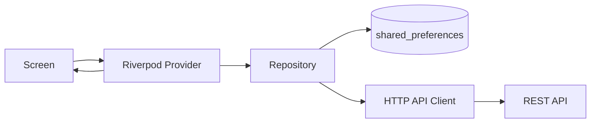

# Arsitektur Smart Split Bill (ChiScan)

## Tujuan

ChiScan adalah aplikasi Flutter berbahasa Indonesia untuk membuat sesi split bill,
mengelola participant, menyimpan sesi secara lokal, dan menyiapkan integrasi REST API.
Mata uang yang didukung adalah Rupiah (IDR).

## Struktur Proyek

```text
apps/mobile/
├── lib/
│   ├── main.dart
│   ├── app.dart
│   ├── models/
│   │   └── bill_session.dart
│   ├── providers/
│   │   ├── bill_session_provider.dart
│   │   └── advanced_features_provider.dart
│   ├── repositories/
│   │   └── bill_session_repository.dart
│   ├── routes/
│   │   └── app_routes.dart
│   ├── screens/
│   │   ├── dashboard_screen.dart
│   │   ├── create_session_screen.dart
│   │   └── session_detail_screen.dart
│   ├── services/
│   │   ├── bill_session_api_client.dart
│   │   ├── camera_scan_service.dart
│   │   ├── location_service.dart
│   │   └── notification_service.dart
│   └── validators/
│       └── bill_session_validator.dart
└── test/
    ├── unit/
    └── widget/
```

## Pembagian Tanggung Jawab

- **Screen** merender UI, menerima input, dan memicu aksi pengguna.
- **Provider** mengelola state asynchronous dengan Riverpod, termasuk loading,
  error, retry, submit, dan pencegahan double-tap.
- **Repository** menjadi kontrak akses data. Implementasi lokal memakai
  `shared_preferences`, implementasi API memakai `BillSessionApiClient`, dan
  implementasi in-memory digunakan untuk test.
- **Service** menangani batas integrasi HTTP dan adapter advanced feature.
- **Model** memvalidasi data `BillSession` serta menyediakan serialisasi JSON.
- **Validator** berisi aturan validasi form.
- **Routes** memusatkan navigasi dashboard, form sesi, dan detail sesi.

## Alur Data



Saat aplikasi dijalankan tanpa backend, repository lokal tetap dapat digunakan.
Base URL API default adalah `http://localhost:3000/api` dan dapat diganti saat
membuat `BillSessionApiClient`.

## Fitur yang Dicakup

1. **P4 State Management**: dashboard memiliki loading, success, empty, error,
   retry, dan form dengan validasi serta anti double-tap.
2. **P5 Local Data & Persistence**: sesi disimpan dengan `shared_preferences`
   dan mendukung create, read, update, serta delete.
3. **P6 API & Vertical Slice**: API client menyediakan GET, POST, PUT, dan
   DELETE untuk `/api/sessions`, dengan parsing model dan penanganan error.
4. **P7 MVP**: navigasi dashboard-form-detail, ringkasan sesi, salin ringkasan,
5. **P8 / UI & UX Quality**:
   - **01 Layout Adaptif**: `AdaptiveContainer` memastikan tampilan proporsional pada layar ponsel sempit (320px) maupun tablet/desktop lebar (1024px+).
   - **02 Keyboard-Safe UI**: `ListView` dengan `keyboardDismissBehavior: onDrag`, `scrollPadding: 140`, `TextInputAction.next/done`, dan penutup keyboard otomatis saat area luar ditekan.
   - **03 Aksesibilitas Dasar (A11y)**: Pemanfaatan `Semantics` label untuk screen reader, target sentuh nyaman (min 48dp), dan teks bantuan/hint pada form.
   - **04 Feedback Aksi**: Status visual instan saat aksi berlangsung (banner progres kamera & GPS, spinner simpan anti double-tap, floating snackbar, dan pull-to-refresh).

## Batasan yang Disengaja

- Backend Node.js/Express dan database MySQL belum berada di repository ini;
  API client hanya mendefinisikan boundary integrasi dan diuji dengan mock HTTP.
- Adapter kamera, lokasi, dan notifikasi saat ini menggunakan simulasi agar alur
  dan state dapat diuji tanpa perangkat atau izin platform. Integrasi perangkat
  nyata memerlukan package/plugin platform dan konfigurasi izin.
- OCR struk otomatis, payment gateway, autentikasi, multi-currency, dan sinkronisasi
  real-time tidak termasuk versi ini.

## Validasi

Jalankan test dari direktori `apps/mobile`:

```text
flutter test
```

Test unit mencakup model valid/invalid, response sukses/kosong, HTTP gagal,
JSON rusak, dan POST. Widget test mencakup kondisi UI utama serta persistence.
